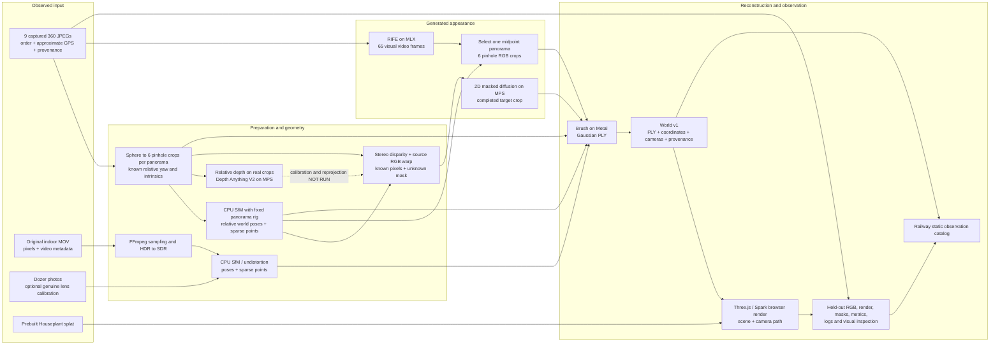

# Groundshift information and processing topology

2026-11-05 inventory of the local repository and retained experiment reports. This is a data-dependency map, not a proposal that every branch improves the final scene. **Held** means bytes or metadata exist locally; **Executed** means the named operation ran; **Candidate** means a possible input or technique that has not been integrated; **Absent** means no such measurement is present in the current sample. A successful export, a visually plausible generated image, and an accurate 3D reconstruction are different claims.

## 1. Inputs and what they actually contain

| Source | Held information | What it does not provide | Evidence |
| --- | --- | --- | --- |
| Beijing Mapillary/Commons sequence | Nine original 7680×3840 equirectangular JPEGs; one-second order; per-image approximate WGS84 latitude/longitude; IDs, source links, hashes, author and CC-BY-SA-4.0 license. Nine-image GPS span is about 11.3 m. | Measured camera orientation/heading, lens-to-world pose, metric-accurate baseline, depth, original sensor frames, IMU, or the globally densest Mapillary region. The panorama seam's zero yaw is not north. | `scripts/samples/mapillary-beijing.json`, `data/samples/mapillary-beijing/acquisition.json`, [Mapillary experiment](MAPILLARY_EXPERIMENT.md) |
| User's original indoor MOV | Original 24.8 s, 1080×1920 display-oriented HDR video and its probe; frame order, video format/color/display metadata and private provenance. Locally extracted 99 SDR frames. | Supplied camera poses, calibrated lens, measured IMU/compass/GPS/ARKit stream, capture-time depth, ground plane, or a walking route. Frame sampling offsets are nominal, not decoded capture timestamps. | [Original video](ORIGINAL_VIDEO.md), [video preparation](VIDEO.md) |
| Dozer raw-image sample | 120 unchanged 1504×1000 JPEGs, ordered selection, hashes, Apache-2.0 provenance; separately available genuine upstream fisheye calibration. | The raw-image acquisition path did not import supplied extrinsics, sparse points, or splats. Its filenames do not supply capture timestamps. | [Samples](SAMPLES.md), [independent reconstruction](INDEPENDENT_RECONSTRUCTION.md) |
| Dozer supplied-pose sample | Forty licensed photographs, real supplied camera transforms and sparse initialization points. | Independently recovered camera poses for that particular first run. | [M1](M1.md) |
| Houseplant sample | One prebuilt, licensed 113,648-splat object asset and source metadata. | Its source images or a walking trajectory; its render is not evidence of local GS training. | [Samples](SAMPLES.md) |
| Future iOS/ARKit capture | **Candidate, not held:** synchronized RGB, camera intrinsics and tracking transforms; supported devices/configurations may also supply scene depth and confidence. A custom capture app/export would be needed. | No ARKit stream exists in Groundshift today. ARKit local tracking is not automatically a globally georeferenced, drift-free route, and depth support must be checked on the actual iPhone. | [Apple camera intrinsics](https://developer.apple.com/documentation/arkit/arcamera/intrinsics), [camera transform](https://developer.apple.com/documentation/arkit/arcamera/transform), [scene depth](https://developer.apple.com/documentation/arkit/arframe/smoothedscenedepth) |
| Future phone sensors | **Candidate, not held:** timestamped gyro, acceleration, compass/magnetometer, GPS accuracy and perhaps device calibration, if explicitly recorded and synchronized. | Ordinary exported video or the current Mapillary manifest does not establish these measurements. Sensor axes, camera-to-sensor transform, clock alignment, biases and uncertainty would need calibration. | No implemented capture/import path |

The public [observation catalog](https://groundshift-viewer-production.up.railway.app/) has 15 exported scene variants and selected experiment images/reports. Railway holds curated *outputs*, not the original private MOV, full source panoramas, model weights, complete logs, or local training environment. The source photos' reuse terms and the user's private-footage permissions differ.

## 2. Executed topology

`──▶` below means an executed dependency. `- -▶` means a candidate dependency that still needs implementation and validation. Observed RGB, estimated geometry and generated RGB are separate lanes.

The arrow from SfM to the RIFE midpoint **does not mean RIFE estimated a pose**. The experiment placed one generated panorama at the already estimated camera rig of real photo 5. The photo 5 RGB was withheld from GS appearance training, but all-image SfM had used it to estimate that pose and initial geometry. The 65 RIFE frames are 65 image hypotheses, **not 65 camera observations**. The 2D inpainted crop similarly borrowed an existing estimated target pose. No generated image independently establishes position, orientation, baseline or parallax.

## 3. Processing inventory: input → new information → dependency/limit

| Processing / status | Required information | Information it produces | Dependency or boundary |
| --- | --- | --- | --- |
| Verify acquisition / **Executed** | Source URL, bytes, per-item hash and license | Reproducible source identity, attribution and local files | License/provenance is separate from geometric accuracy. Fresh Commons fetch may be rate-limited. Direct Mapillary Graph API was blocked without a token. |
| Video sampling/color / **Executed** | MOV, display orientation, video/color tags, FFmpeg | Ordered SDR JPEGs, dimensions, nominal offsets, hashes and logs | Does not recover physical poses or actual frame PTS. HDR requires zscale/tonemap; no IMU is extracted. |
| Panorama projection / **Executed** | Original 360 RGB, chosen yaw/pitch/FOV and output resolution | Six 512² overlapping perspective crops per sphere and exact *relative* rotations/intrinsics | The six views share a virtual center. `yaw=0` is relative to the pano image, not geographic north; world translation is still unknown. Widened 768²/120° source crops were also tested. |
| Pose estimation / **Executed** | Overlapping observed RGB, camera intrinsics/model and known panorama rig; optional correct image order | Matched features, estimated world camera rotations/centers, sparse 3D points, registration/reprojection diagnostics | PyCOLMAP yields an internally consistent **arbitrary-scale** frame; GPS and gravity are not integrated. Unconstrained six-camera panorama SfM failed co-location despite 54/54 registration; fixed-rig SfM corrected co-location. |
| Sparse-depth evidence / **Executed** | SfM poses, calibrated rays and triangulated point tracks | Sparse per-feature 3D locations/depth; triangulation angles and point colors | Low parallax leaves many points weak. Reprojection error and exact rig constraints do not certify geometry everywhere. |
| Learned monocular depth / **Executed diagnostic** | One real 512² crop and pinned Depth Anything V2 Small weights | Dense *relative* depth array/visualization for each of photos 4, 5, 6 | M2/MPS ran. Depth order correlates 0.876–0.913 with the same all-image SfM's sparse inverse-Z; this is internal evidence, not independent truth, meters or cross-view consistency. |
| Stereo disparity and reprojection / **Executed** | Two observed RGB crops, two estimated poses/intrinsics, target camera pose | Disparity/depth estimate, z-buffered target RGB fragments, binary unknown mask and coverage report | Best corrected wide-FOV test filled 24.877% of target; 75.123% remained unknown. Target RGB was excluded from this computation; target pose came from all-image SfM. |
| GS render-gap mask / **Executed** | Existing Gaussian PLY and requested camera | Rendered RGBA, composite and low-opacity mask | Transparent pixels are a hole heuristic; opaque-but-wrong pixels are not detected. |
| 2D diffusion inpainting / **Executed** | A partial target RGB image, binary mask, prompt, seed and MPS model | Synthesized RGB in masked region plus hashes/settings/log | Keeps unmasked pixels, but does not guarantee multiview 3D consistency. The observed street trial invented details and did not pass faithful-view quality. |
| RIFE optical-flow interpolation / **Executed** | Observed full panoramas 4 and 6, local weights, seam handling | 65 visually interpolated 2048×1024 panorama frames and video | Intermediate RGB is generated, not newly measured. Near objects double/melt; 3D augmentation did not improve the compared GS views. This is not diffusion. |
| Full video diffusion / **Candidate, NOT RUN** | Endpoint RGB, intended conditioning/trajectory, compatible weights and local inference resources | Potentially novel panorama RGB/temporal sequence | LTX-2.3-MLX CLI was examined, but required q8 weights were too large/slow to acquire here; no inference. ViewCrafter/SEVA were examined, without verified M2 execution. No multiview consistency result exists. |
| Pose-conditioned multiview depth / **Candidate, NOT RUN** | Several RGB views plus trustworthy intrinsics/poses | Potentially cross-view-aligned depth/confidence and 3D points | Depth Anything 3 exposes this API; the repo's M2/MPS path has not been run. Its documented direct Gaussian export needs giant variants, not the tested V2 Small. |
| Synthetic-view dataset assembly / **Executed** | Real training images, *existing* target camera/intrinsics, generated RGB and provenance | Explicit real/synthetic training manifest and checksums | If the target RGB enters training it ceases to be a held-out RGB test. No pose may be invented by image generation. |
| Gaussian optimization / **Executed** | Posed pinhole RGB, intrinsics, sparse initialization and provenance | Splat positions, shape/rotation, opacity, color/SH and PLY | Brush/Metal ran on Dozer, private MOV and Mapillary crops. More steps/capacity did not fix the bounded panorama quality failure. Generated RGB can add inconsistent supervision. |
| Portable export and viewing / **Executed** | PLY, coordinate conversion, verified camera matrices, metadata | `world.json`, `scene.ply`, optional `cameras.json`; browser navigation and render | World v1 has explicit right-handed Y-up transform and `arbitrary` or `meters`. Current Mapillary scale is arbitrary. Camera-path interpolation is UI behavior, not a measured walking surface. |
| Comparison and publication / **Executed** | Held-out observed RGB, rendered/generated RGB, masks, provenance, license and logs | Coverage, MAE/PSNR, screenshots, PASS/FAIL/NOT RUN and static report | Photo 5 was an **appearance** holdout, not pose/geometry independence. Pixel metrics do not prove 3D plausibility. Railway receives an allowlisted static subset and does no reconstruction. |

## 4. Information that could connect the branches, but does not yet

| Potential information / status | How to obtain it | What it could constrain | Additional dependency before it becomes usable |
| --- | --- | --- | --- |
| Approximate metric camera baseline / **GPS held; alignment NOT RUN** | Convert each existing WGS84 point to a local East-North-Up frame; robustly align estimated SfM camera centers with GPS by a similarity transform. | Trajectory direction and global scale *approximately*; weak prior on where two photos were taken. | GPS accuracy/noise and datum/altitude must be checked. GPS positions alone do not orient each 360 sphere or resolve near-field depth. Alignment must be measured; never label the current world as meters just because GPS exists. |
| Global panorama heading / **Absent** | Obtain trustworthy compass/heading metadata or estimate orientation from a calibrated sensor/camera rig, then reconcile with SfM. | Yaw alignment of a panorama to the map and possible pose initialization. | The current manifest has no heading field. Magnetic north needs calibration/declination handling; pano seam/stitch orientation must be related to the sensor. |
| Gravity and camera/sensor motion / **Absent** | Future synchronized gyro/accelerometer or ARKit tracking. | Rotation prior, gravity-up, short-term motion and pose-estimation initialization. | Clock sync, camera-to-IMU extrinsics, biases and drift; acceleration is not a reliable standalone translation by double integration. |
| Measured depth / **Absent for this sequence** | A supported future ARKit depth capture, stereo/depth sensor or independent reference measurement. | Scale/geometry constraint, depth validation, occlusion-aware reprojection. | Actual device support, camera/depth alignment, confidence and valid-range checks. Current learned depth is relative, not measured depth. |
| Dense depth in SfM coordinates / **NOT RUN** | Fit per-view scale/shift or inverse-depth mapping to sparse SfM points, then enforce cross-view reprojection agreement; compare photo 5 without using its RGB in training. | Potentially larger known-pixel coverage, 3D point seeding, depth regularization and more reliable inpaint masks. | Avoid overfitting same-image sparse points; report metric-agnostic errors, occlusions and conflicting views. A plausible depth color map alone is insufficient. |
| Truly new target camera / **NOT RUN** | Validated metric/relative trajectory interpolation with pose uncertainty, ARKit capture, or source-only SfM/georegistration. | A pose to which novel RGB can be assigned without borrowing the withheld photo's solved pose. | A generated frame has no intrinsic camera location. Interpolated trajectory poses are hypotheses until checked against a real view or independent sensor. |
| Multiview-consistent hallucination / **NOT RUN** | Generate/refine several overlapping target views jointly with shared cameras/depth/visibility and test on withheld physical positions. | Coherent 3D appearance, if a supported local model and data allow it. | Consistency, memory, license and M2 feasibility must be validated. One pretty image or 2D temporal coherence does not establish this. |
| Spherical dense depth / **NOT RUN** | Predict depth for all directions or stitch calibrated overlapping crop predictions into one panorama. | A depth/ray hypothesis over the full 360° capture rather than one crop. | Crop-relative scales, boundaries and overlap must agree; the existing three V2 maps are per-view and separately normalized for display. |
| Motion/semantic and exposure evidence / **NOT RUN** | Detect moving people/foliage/vehicles and estimate consistent color/exposure from the observed photographs. | Masks or weights that could keep transient objects and brightness changes from misleading SfM/GS. | No reliable labels or photometric calibration are currently stored. A model's segmentation is an estimate, not ground truth. |
| Dense geographic coverage / **NOT HELD** | Authorized Mapillary API access or another properly licensed source; select by scene overlap, useful parallax and static content, not just frame count. | More physical viewpoints/angles and potentially stronger geometric constraints. | The nine-photo sample is small and not a global-density optimum. Source terms, API access and download limits apply. Distant views may add angles but fewer useful pixels for nearby objects. |

## 5. Variables we can deliberately change

| Variable | Available choices / present test | What information changes | Dependency/tradeoff |
| --- | --- | --- | --- |
| Physical camera positions and route length | Nine observed stations; endpoint 4→6; potentially a longer sequence | More *real* parallax and angles around the same object | Only useful when the object remains visible with enough pixels and overlapping features. GPS is approximate; new originals need acquisition and license checks. |
| 360 sphere coverage | Full 7680×3840 original is already equirectangular (unwrapped); 2048×1024 full-sphere generation ran | All directions per physical position | A single sphere offers angular coverage but no translational baseline for its own objects. Horizon seam and nadir obstruction require handling. |
| Crop direction, count, FOV and resolution | Six yaw directions at 60° intervals, 90° FOV, 512²; stereo sources also tested at 120°/768² | Angular overlap, feature pixels and ray calibration | More crops from the *same sphere* do not add physical positions. Intrinsics must be recomputed exactly after cropping/resizing. |
| Video frame sampling | Original MOV sampled at 4 fps / 99 frames, up to 960px; source 30 fps video | Number of observed RGB images offered to SfM/GS | Keeping all compressed frames adds near-duplicates, compute and motion blur; skipping too many loses overlap. Nominal offsets are not measured camera poses. |
| Generated-frame count | RIFE made 65 full spheres; only one midpoint sphere became six GS views | 2D temporal density versus number of training images | The 65 frames do not create 65 known physical stations. More synthetic crops can amplify pose and appearance contradictions. |
| Depth model and resolution | V2 Small ran on three 512² real crops; DA3 multi-view remains unrun | Relative depth detail, perhaps cross-view confidence with a suitable model | Needs calibration, cross-view checks, M2 memory validation and separate licensing before GS use. |
| Gap-filling method | Observed-pixel stereo warp, gray control, SD1.5 masked inpaint, RIFE optical flow; LTX candidate unrun | Fraction of genuinely sourced pixels versus invented appearance | Generated areas may look plausible yet disagree in 3D. Preserve masks and provenance. |
| Gaussian budget | 2k/10k/20k steps and 150k/750k maximum splats were tested | Model fitting capacity and output size | Larger trial worsened the measured held-out panorama view; geometry and supervision are upstream dependencies. |
| Evaluation split | Photo 5 RGB held out of GS; its camera pose/initial geometry came from all-image SfM | Appearance comparison at a known estimated pose | Source-only pose estimation or external pose measurement is required for an independent geometry/novel-location test. |

## 6. Practical dependency order for the next bounded experiment

1. **Observed source geometry:** keep panorama 5 RGB out of the generation/training input; audit endpoint 4/6 poses, intrinsics, sparse tracks and GPS quality separately. Decide whether the evaluation is appearance-only (reuse all-image SfM pose) or independent geometry (source-only poses plus a separately obtained target pose). Do not mix the labels.
2. **Calibrate learned depth:** turn endpoint relative depth into *SfM-scale* depth using only endpoint sparse observations; measure consistency between endpoints, confidence and occlusion before generating RGB. This does not create meters until an independent scale is established.
3. **Warp and compare:** forward-project only observed endpoint pixels to the target camera with a z-buffer; compare known-pixel coverage and error with the 24.877% stereo baseline. The target pose must be explicitly marked estimated or measured.
4. **Fill only remaining unknowns:** run the already available local inpainting path if coverage improves, and compare against gray-fill and RIFE controls. Keep masks, generated-pixel provenance and the withheld image distinct.
5. **Train a matched GS pair:** same observed images, camera poses, training budget and browser cameras, with and without the selected generated views. Inspect multiple render directions and report both perceptual plausibility and held-out RGB diagnostics. Publish both outcomes to the static observation surface regardless of quality.

The highest-value unresolved edge is **dense depth + trustworthy camera geometry → more observed-pixel coverage at a genuinely new viewpoint**. More generated frames or more splats cannot substitute for that edge on their own.
